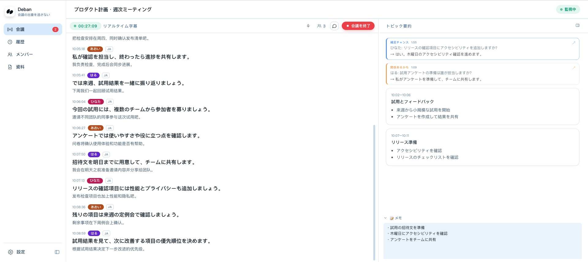

<h1 align="center"> Deban</h1>

[English](README.md) | [简体中文](README.zh-CN.md) | 日本語

Deban はデスクトップアプリまたはブラウザで動作し、会議の音声を手元のコンピューターで文字起こしします。録音の保存、文字起こしの編集、過去の会議の検索ができます。AI 接続を設定すると、翻訳、回答案、会議の要約も利用できます。



## 機能

- **リアルタイム文字起こしと録音** — デスクトップ版ではシステム音声、Web 版ではブラウザのタブで共有した音声を取得し、必要に応じてマイク音声を取り込み、日本語・中国語・英語をローカルで文字起こしします。会議中に字幕を確認し、録音を保存できます。
- **話者の管理** — ローカルの声紋を使って話者を識別し、マイク入力から自分の発言を区別します。参加者の管理や話者の割り当て修正もできます。
- **会議アシスト** — AI サービスを設定すると、発言の翻訳、応答が必要になりそうな場面の通知、異なる態度での回答案、話題の要約、決定事項、アクション項目を利用できます。
- **会議のコンテキスト** — 会議の概要、プロフィール、用語集、参考資料を追加できます。会議ごとに資料と優先度を選び、前回の会議からコンテキストを引き継げます。
- **会議履歴** — 会議を検索・確認し、字幕の編集や分割、メモの追加、録音の再生、Markdown または SRT 形式での字幕のエクスポートができます。
- **ローカルデータとバックアップ** — 会議データを端末に保存し、削除済み項目を管理できます。`.deban` アーカイブのインポートとエクスポートに対応し、バックアップに声紋を含めるか選べます。
- **言語と AI の設定** — 画面は日本語、英語、簡体字中国語、繁体字中国語に対応します。自分の AI サービスを接続し、モデルとキーを設定できます。

## ダウンロードとインストール

### macOS デスクトップ版

[Deban をダウンロード（Apple Silicon、macOS 15 以降）](https://github.com/YangXingchao/Deban/releases/download/v1.0.9/Deban-1.0.9-macos-arm64.dmg)。DMG を開き、Deban を「アプリケーション」にドラッグします。ローカルバックエンドは同梱され、ターミナルや Python、Node.js のインストールは不要です。画面とシステム音声の収録を許可してください。初回起動時に音声モデルがダウンロードされます。

### Windows デスクトップ版

[Deban Windows x64 インストーラーをダウンロード](https://github.com/YangXingchao/Deban/releases/download/v1.0.9/Deban_1.0.9_x64-setup.exe)。インストーラーを実行して Deban を起動します。ローカルバックエンドは同梱されています。インストーラーは未署名です。必要に応じてマイクを許可してください。初回起動時に音声モデルをダウンロードします。

### ソースから Web 版を起動

Python 3.12、uv、Node.js 22、npm、比較的新しい Chrome または Edge が必要です。リポジトリのディレクトリで実行してください。

```sh
uv sync --frozen
npm --prefix ui ci
npm --prefix ui run build
uv run --frozen python main.py
```

[http://127.0.0.1:8765](http://127.0.0.1:8765) を開きます。初回は Hugging Face からローカル音声・話者モデルをダウンロードします。モデルには約 600 MB、依存関係と録音には別途空き容量が必要です。サーバーはローカルのループバックアドレスで待ち受けます。

## デスクトップ版のビルド

Deban は独立したデスクトップウィンドウでも利用できます。Apple Silicon と macOS 15 以降の Mac で Xcode コマンドラインツール、uv、Node.js 22 をインストールし、`./scripts/build-macos.sh` を実行すると `dist/Deban.app` が生成されます。

64 ビット Windows では uv、Node.js 22、Rust、Tauri CLI 2 をインストールし、PowerShell で `./scripts/build-windows.ps1` を実行してください。インストーラーは `src-tauri/target/release/bundle/` に生成されます。デスクトップ版は他のアプリを含むシステム音声を取得し、マイク音声も選択できます。画面の案内に従い権限を許可してください。初回起動時に音声モデルがダウンロードされます。Windows ビルドは未署名です。macOS ビルドは利用可能な Developer ID 証明書（`DEBAN_MAC_SIGN_ID` で指定可能）、なければアドホック署名を使用し、公証は行いません。アドホック署名では再ビルド後に再許可が必要な場合があります。

デスクトップパッケージには Deban バックエンドの `.py` ソースではなく、コンパイル済み Python バイトコードが含まれます。サードパーティのランタイムファイルは残ります。ビルドによってソースリポジトリのファイルが削除されることはありません。デスクトップビルドのワークフローは macOS アプリと Windows インストーラーも成果物としてアップロードします。

GitHub Release 用 macOS インストーラーには Developer ID 証明書と Apple 公証の認証情報が必要です。`./scripts/build-macos.sh` の後に `./scripts/package-macos-release.sh` を実行すると、署名・公証・検証済みの `dist/Deban-<version>-macos-arm64.dmg` と SHA-256 ファイルが生成されます。キーチェーンのプロファイルは既定で `deban`、`DEBAN_NOTARY_PROFILE` で変更できます。通常のデスクトップビルド成果物は公証されていません。

## 会議を録音する

Web 版の場合：

1. ブラウザの別のタブで会議を開きます。
2. Deban で会議の言語を選び、マイクの使用と録音の保存を設定します。
3. 会議を開始し、ブラウザの共有ダイアログで会議のタブを選んで**タブの音声を共有**を有効にします。録音中は Deban のページを開いたままにします。Deban は共有された音声トラックを処理します。
4. 会議の終了後、**履歴**から文字起こしを確認、編集、エクスポートできます。

Web 版ではブラウザのタブ共有で音声を取得し、デスクトップ版ではほかのアプリのシステム音声も取得できます。

## AI を接続する

**設定 → AI 接続**を開き、OpenAI、Anthropic、Google Gemini、Grok、Kimi、DeepSeek、OpenRouter、OpenCode Zen、または OpenAI API 互換サービスを選びます。モデル ID と API Key を入力し、接続をテストして保存します。OpenAI API 互換サービスでは API Base URL も入力します。ローカルサービスの例は `http://127.0.0.1:11434/v1` です。リモート URL には HTTPS を使用します。

Key はローカルサーバーのデータディレクトリに保存されます。接続テストでは短いテスト用プロンプトを送信します。AI 機能では、会議のテキストと、必要に応じて資料の抜粋やプロフィール情報が選択したサービスに送信されます。録音と文字起こし処理は手元の端末で行われます。AI を設定しなくても録音、文字起こし、履歴の閲覧ができます。

## データと移行

データはデフォルトで `~/.local/share/deban` に保存されます。`$XDG_DATA_HOME` が設定されている場合は `$XDG_DATA_HOME/deban` を使います。`MC_DATA_DIR` で別のディレクトリも指定できます。バックエンドのログは `app.log` です。

旧バージョンからデータを移行するには、旧バージョンで `.deban` アーカイブをダウンロードし、**設定 → データとバックアップ**からインポートします。会議は重複を除いてインポートされます。API Key と AI 接続設定はアーカイブに含まれません。

[変更履歴](CHANGELOG.md)と[第三者ライセンスの通知](THIRD_PARTY_NOTICES.md)も参照してください。

## ライセンス

Deban は [MIT License](LICENSE) の下で提供されます。
