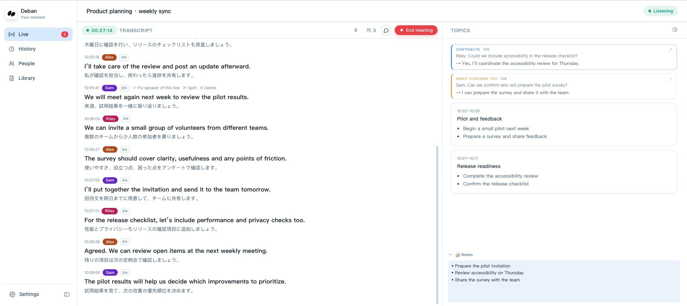

<h1 align="center"> Deban</h1>

English | [简体中文](README.zh-CN.md) | [日本語](README.ja.md)

Deban runs as a desktop app or in your browser and transcribes meeting audio on your computer. You can save the recording, edit the transcript and search past meetings. An optional AI connection enables translation, suggested replies and meeting summaries.



## Features

- **Live transcription and recording** — Capture audio shared from a browser tab, optionally include your microphone, and transcribe Japanese, Chinese or English locally. Save recordings and follow the transcript as the meeting progresses.
- **Speaker management** — Recognize speakers with local voiceprints, identify your own microphone channel, manage participants and correct speaker assignments.
- **Meeting assistance** — Configure an AI provider to translate speech, identify moments when you may want to respond, suggest replies in different tones, and generate topic summaries, decisions and action items.
- **Meeting context** — Add a meeting brief, personal profile, glossary and reference documents. Select materials and their priority for each meeting, and carry context forward from an earlier meeting.
- **Meeting history** — Search and review meetings, edit or split transcript entries, add notes, play saved audio, and export transcripts as Markdown or SRT.
- **Local data and backups** — Keep meeting data on your computer, manage deleted items, and export or import `.deban` archives. Choose whether to include voiceprints in a backup.
- **Language and AI settings** — Use the interface in English, Japanese, Simplified Chinese or Traditional Chinese. Connect your own AI provider and configure its model and key.

## Download and install

### macOS desktop app

[Download Deban for Apple Silicon (macOS 15+)](https://github.com/YangXingchao/Deban/releases/download/v1.0.9/Deban-1.0.9-macos-arm64.dmg). Open the DMG and drag Deban to Applications. The app includes its local backend; no terminal, Python or Node.js installation is needed. Allow screen and system audio recording when prompted. The first launch downloads speech models.

### Windows desktop app

A Windows x64 installer is being prepared. Check [GitHub Releases](https://github.com/YangXingchao/Deban/releases) for availability. Desktop builds capture system audio and can include the microphone.

### Web app from source

Install Python 3.12, uv, Node.js 22 with npm, and a recent Chrome or Edge. In the repository directory run:

```sh
uv sync --frozen
npm --prefix ui ci
npm --prefix ui run build
uv run --frozen python main.py
```

Open [http://127.0.0.1:8765](http://127.0.0.1:8765). The first launch downloads local speech and speaker models from Hugging Face; allow about 600 MB for models and additional space for dependencies and recordings. The server listens on loopback.

## Desktop builds

Deban can also run in a standalone desktop window. On Apple Silicon Macs with macOS 15 or newer, install Xcode command-line tools, uv and Node.js 22, then run `./scripts/build-macos.sh`. The app is created at `dist/Deban.app`. The build uses the configured Developer ID certificate when available (`DEBAN_MAC_SIGN_ID` can select one), or ad-hoc signing otherwise. Ad-hoc builds may require permissions to be granted again after rebuilding.

On 64-bit Windows, install uv, Node.js 22, Rust and Tauri CLI 2, then run `./scripts/build-windows.ps1` in PowerShell. The installer is created under `src-tauri/target/release/bundle/`. Desktop builds capture system audio, including audio from other applications, and can optionally include the microphone. Grant the requested system permissions when prompted. The first launch downloads the speech models. Windows builds are unsigned; macOS builds are not notarized.

Desktop packages contain compiled Python bytecode for Deban's backend instead of its `.py` source files. Third-party runtime files remain in the package. Building does not remove files from the source checkout. The desktop build workflow also uploads the macOS app and Windows installer as artifacts.

For a GitHub Release, run `./scripts/build-macos.sh` followed by `./scripts/package-macos-release.sh` with a Developer ID certificate and Apple notarization credentials. The latter produces a signed, notarized and verified `dist/Deban-<version>-macos-arm64.dmg` and SHA-256 file. The keychain profile defaults to `deban` and can be changed with `DEBAN_NOTARY_PROFILE`. Artifacts from the ordinary desktop build workflow are not notarized.

## Record a meeting

1. Open the meeting in another browser tab.
2. In Deban, select the source language and choose whether to include your microphone and save the recording.
3. Start the meeting, select the meeting tab in the browser's sharing dialog and enable **Share tab audio**. Keep Deban open while it records. Deban processes the audio track from the share.
4. End the meeting and open **History** to view, edit or export the transcript.

In the web app, capture uses browser tab sharing; desktop apps capture system audio from other applications.

## Connect AI

Open **Settings → AI connection** and choose OpenAI, Anthropic, Google Gemini, Grok, Kimi, DeepSeek, OpenRouter, OpenCode Zen or an OpenAI-compatible provider. Enter the model ID and API key, test the connection and save. For an OpenAI-compatible connection, enter the service's API base URL, such as `http://127.0.0.1:11434/v1` for a local service. Remote URLs use HTTPS.

The key is stored in the local server's data directory. The test sends a short test prompt. AI features send transcript text and, where relevant, document excerpts and profile information to the selected provider. Recordings and the transcription process stay local. Recording, transcription and history work without an AI connection.

## Data and migration

Data is stored under `~/.local/share/deban` by default, or under `$XDG_DATA_HOME/deban` when set. Set `MC_DATA_DIR` to use another directory. The backend log is named `app.log`.

To move data from an earlier Deban installation, download a `.deban` archive from the previous installation and import it under **Settings → Data & backup**. Imports deduplicate meetings. API keys and AI connection settings are excluded from archives.

See the [changelog](CHANGELOG.md) and [third-party notices](THIRD_PARTY_NOTICES.md).

## License

Deban is released under the [MIT License](LICENSE).
