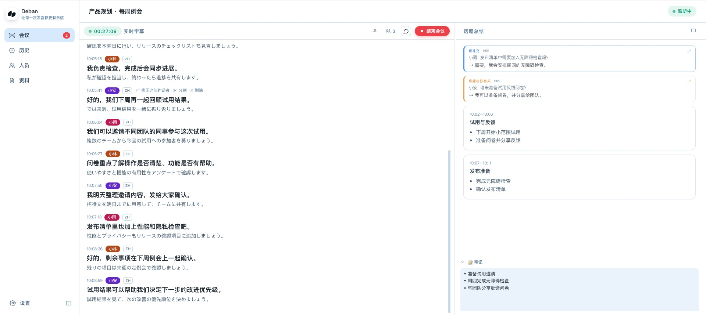

<h1 align="center"> Deban</h1>

[English](README.md) | 简体中文 | [日本語](README.ja.md)

[官方网站](https://deban.app/) · [桌面版最新版本](https://github.com/YangXingchao/Deban/releases/latest) · [更新日志](CHANGELOG.md)

Deban 可作为桌面应用或在浏览器中运行，在电脑本地转写会议音频。你可以保存录音、编辑字幕和搜索历史会议。配置 AI 连接后，还可以使用翻译、建议回答和会议总结。



## 功能

- **实时转写与录音** — 桌面版采集系统音频，Web 版采集浏览器标签页共享的音频，可选加入麦克风，在本地转写日语、中文或英语。会议中查看字幕，并可保存录音。
- **说话人管理** — 使用本地声纹识别说话人，通过麦克风通道识别自己的发言，管理参会人员并修正说话人归属。
- **会议辅助** — 配置 AI 服务后，可以翻译发言、提示可能需要回应的时机、生成不同态度的建议回答，以及整理话题摘要、决定和行动事项。
- **会议上下文** — 添加会议简介、个人资料、术语表和参考文件，为每场会议选择资料及优先级，也可以沿用上一次会议的上下文。
- **会议历史** — 搜索和回顾会议，编辑或拆分字幕、添加备忘、播放录音，并将字幕导出为 Markdown 或 SRT。
- **本地数据与备份** — 会议数据保存在本机，支持管理已删除的项目，以及导入和导出 `.deban` 归档。备份时可选择是否包含声纹。
- **语言和 AI 设置** — 界面支持简体中文、繁体中文、日语和英语。可以连接自己的 AI 服务，并配置模型与密钥。

## 下载和安装

### macOS 桌面版

[下载 Deban（Apple Silicon，macOS 15 或更高版本）](https://github.com/YangXingchao/Deban/releases/latest)。打开 DMG，将 Deban 拖入“应用程序”。应用已包含本地后端，无需终端，也不需要安装 Python 或 Node.js。按提示允许屏幕和系统音频录制；首次启动会下载语音模型。 关闭窗口后 Deban 会继续运行。点击 Dock 图标可重新打开窗口，按 Command–Q 可退出。

### Windows 桌面版

[下载 Deban Windows x64 安装包](https://github.com/YangXingchao/Deban/releases/latest)。运行安装程序后打开 Deban，应用已包含本地后端。安装包未签名；请按提示允许麦克风访问，首次启动会下载语音模型。

### 从源码运行 Web 版

需要 Python 3.12、uv、Node.js 22、npm 和较新版本的 Chrome 或 Edge。在项目目录中运行：

```sh
uv sync --frozen
npm --prefix ui ci
npm --prefix ui run build
uv run --frozen python main.py
```

打开 [http://127.0.0.1:8765](http://127.0.0.1:8765)。首次启动会从 Hugging Face 下载本地语音和说话人模型，模型约需 600 MB，依赖和录音需要额外空间。服务只监听本机回环地址。

## 桌面版构建

Deban 也可以在独立桌面窗口中运行。在 Apple Silicon、macOS 15 或更高版本上，安装 Xcode 命令行工具、uv 和 Node.js 22，然后运行 `./scripts/build-macos.sh`，应用生成在 `dist/Deban.app`。

在 64 位 Windows 上，安装 uv、Node.js 22、Rust 和 Tauri CLI 2，在 PowerShell 中运行 `./scripts/build-windows.ps1`，安装包生成在 `src-tauri/target/release/bundle/`。桌面版采集系统声音，包括其他应用的声音，也可以选择录制麦克风；请按提示授予系统权限。首次启动会下载语音模型。Windows 构建未签名；macOS 构建优先使用可用的 Developer ID 证书（可通过 `DEBAN_MAC_SIGN_ID` 指定），否则使用临时签名，且未进行公证。临时签名的应用重新构建后可能需要再次授权。

桌面安装包中的 Deban 后端以 Python 字节码提供，不包含其 `.py` 源文件；第三方运行时文件会保留。构建不会删除源码仓库中的文件。桌面构建工作流也会上传 macOS 应用和 Windows 安装包。

用于 GitHub Release 的 macOS 安装包需要 Developer ID 证书和可用的 Apple 公证凭据。先运行 `./scripts/build-macos.sh`，再运行 `./scripts/package-macos-release.sh`；后者生成经过签名、公证及验证的 `dist/Deban-<版本>-macos-arm64.dmg` 和 SHA-256 文件。默认使用钥匙串公证配置 `deban`，可用 `DEBAN_NOTARY_PROFILE` 覆盖。普通桌面构建工作流产物没有经过公证。

## 录制会议

Web 版操作步骤：

1. 在浏览器的另一个标签页打开会议。
2. 在 Deban 中选择会议语言，并选择是否使用麦克风和保存录音。
3. 开始会议，在浏览器的共享对话框中选择会议标签页并启用**共享标签页音频**。录制期间保持 Deban 页面打开。Deban 处理共享内容中的音轨。
4. 结束会议后，在**历史**中查看、编辑或导出转写。

Web 版通过浏览器共享标签页采集音频；桌面版可以采集其他应用的系统音频。

## 连接 AI

打开**设置 → AI 连接**，选择 OpenAI、Anthropic、Google Gemini、Grok、Kimi、DeepSeek、OpenRouter、OpenCode Zen 或兼容 OpenAI API 的服务。输入模型 ID 和 API Key，测试连接后保存。使用兼容 OpenAI API 的服务时，还需输入 API Base URL，本地服务的示例为 `http://127.0.0.1:11434/v1`。远程地址使用 HTTPS。

Key 保存在本地服务的数据目录中。测试连接会发送一条简短的测试提示。启用 AI 功能时，会议文字以及相关的资料片段和个人资料会发送给所选服务商。录音和转写过程保留在本机。未配置 AI 时仍可录音、转写和查看历史。

## 数据和迁移

默认数据目录为 `~/.local/share/deban`。设置了 `$XDG_DATA_HOME` 时，使用 `$XDG_DATA_HOME/deban`。也可以设置 `MC_DATA_DIR` 指定其他目录。后端日志文件名为 `app.log`。

从旧版 Deban 迁移时，先在旧版下载 `.deban` 归档，再通过**设置 → 数据与备份**导入。导入会按会议去重。归档不包含 API Key 和 AI 连接设置。

参见[更新日志](CHANGELOG.md)和[第三方声明](THIRD_PARTY_NOTICES.md)。

## 许可证

Deban 使用 [MIT 许可证](LICENSE)。
